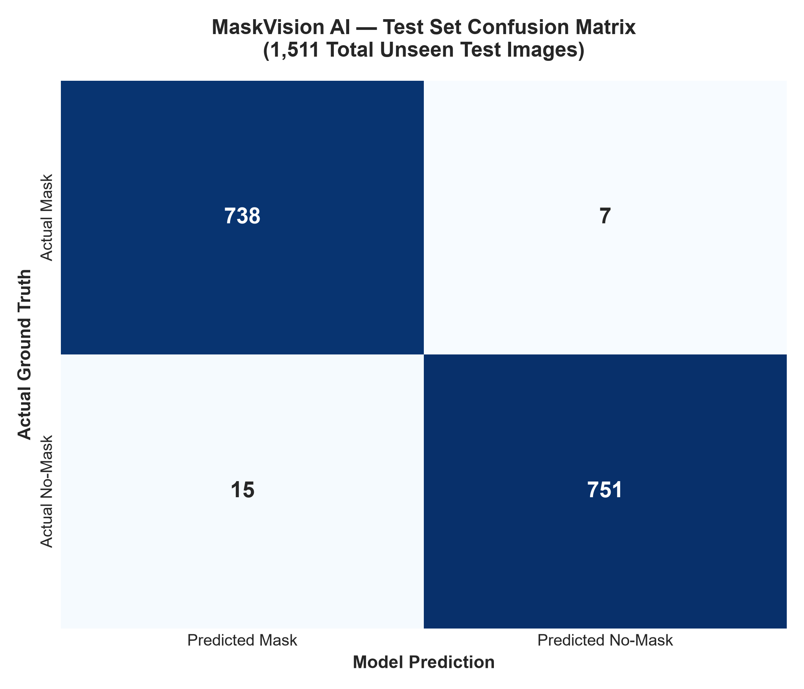
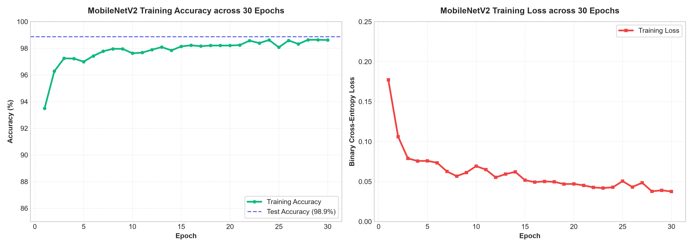
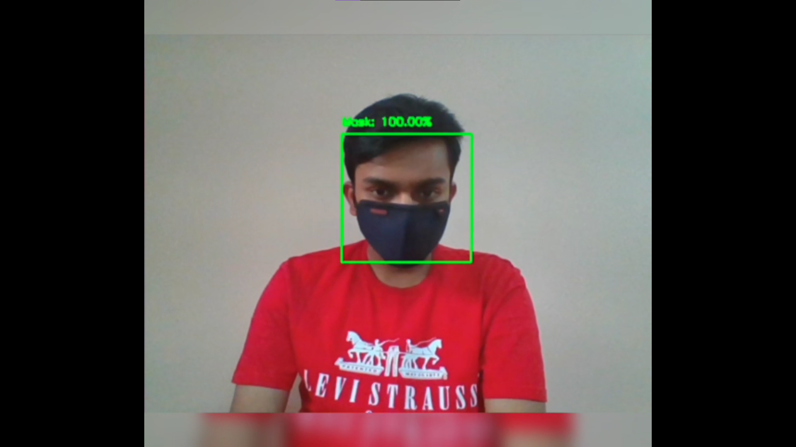

<div align="center">

# 😷 MaskVision AI
### Real-Time Face Mask Detection & Visual Analytics

[](https://python.org)
[](https://tensorflow.org)
[](https://opencv.org)
[](https://streamlit.io)
[](LICENSE)

An end-to-end Computer Vision and Deep Learning application that detects human faces in static images, pre-recorded video, and live camera streams, classifying whether individuals are wearing face masks with **98.9% empirical test accuracy**.


</div>

---

## 📋 Table of Contents

1. [Project Overview](#1-project-overview)
2. [Problem Statement](#2-problem-statement)
3. [Key Features](#3-key-features)
4. [Technology Stack](#4-technology-stack)
5. [System Architecture](#5-system-architecture)
6. [Project Structure](#6-project-structure)
7. [Installation & Setup](#7-installation--setup)
8. [Running the Application](#8-running-the-application)
9. [Empirical Model Performance & Evaluation](#9-empirical-model-performance--evaluation)
10. [Example Results & Visualizations](#10-example-results--visualizations)
11. [Technical Limitations](#11-technical-limitations)
12. [Future Improvements](#12-future-improvements)
13. [Interview Preparation Guide](#13-interview-preparation-guide)

---

## 1. Project Overview

**MaskVision AI** is a Computer Vision and Deep Learning project that automatically localizes faces in visual media and classifies whether detected individuals are wearing face masks. 

Unlike single-step object detectors that attempt to classify small, distant, or varied faces directly, MaskVision AI decouples the problem into a specialized **two-stage pipeline**:
1. **Face Localization Stage:** A deep Single Shot MultiBox Detector (SSD) built upon a ResNet-10 framework reliably extracts facial regions of interest (ROIs).
2. **Mask Classification Stage:** A fine-tuned **MobileNetV2** convolutional neural network, trained via transfer learning, predicts whether each extracted face is wearing a mask or not.

The project provides an interactive **Streamlit** dashboard delivering instant visual annotations, detection statistics, frame-by-frame video processing, live camera support, and transparent deep learning model analytics.

---

## 2. Problem Statement

Automated visual compliance monitoring is a classic computer vision challenge with applications across industrial safety, sterile pharmaceutical cleanrooms, medical facilities, and high-density transportation hubs. Manual monitoring is labor-intensive, error-prone, and unscalable during public health protocols or cleanroom operations.

However, face mask classification introduces distinct vision challenges:
- **Masks obscure the lower two-thirds of the face**, depriving traditional facial recognition algorithms of key landmarks (nose, mouth, jawline).
- **Varied face orientations, scales, lighting, and distances** make unified detection difficult.
- **Computational efficiency matters:** The system must run smoothly on standard CPU hardware without requiring dedicated enterprise GPU clusters.

MaskVision AI addresses these challenges through a lightweight, optimized architecture that separates face detection from binary classification.

---

## 3. Key Features

- **🖼️ Static Image Detection:** Upload any JPG, PNG, or WEBP image. The pipeline detects single or multiple faces, calculates mask compliance, renders high-contrast bounding boxes, and generates a structured statistical breakdown with downloadable results.
- **🎥 Video Detection & Analytics:** Processes uploaded MP4, AVI, or MOV files frame-by-frame with progress indicators, real-time preview frames, safe temporary file management, and annotated video export.
- **📷 Live Camera Detection:**
  - *In-Browser Camera:* Cross-platform snapshot capture working smoothly across local and cloud deployments (including Streamlit Cloud and mobile browsers).
  - *Native OpenCV Stream:* Interactive webcam stream for local machine execution with start/stop keyboard controls (`Q` to exit).
- **📊 Detection Analytics:** Real-time metrics tracking total faces detected, count/percentage wearing masks, count/percentage unmasked, and average confidence scores.
- **🎚️ Configurable Confidence Slider:** User-adjustable face detection confidence threshold (20% to 95%) with clear separation between face localization probability and mask classification certainty.
- **🧠 Deep Learning Model Insights:** Dedicated analytics tab displaying verified test accuracy, precision, recall, F1-scores, the complete 1,511-image confusion matrix, and 30-epoch training loss/accuracy curves.
- **🛡️ Bulletproof Error Handling:** Graceful user-friendly feedback for empty inputs, images with no detectable faces, missing weights, corrupted videos, or unavailable camera devices without raw stack traces.

---

## 4. Technology Stack

| Technology | Role in System |
|---|---|
| **Python 3.8+** | Core programming language |
| **OpenCV (cv2)** | Image preprocessing, video capture/writing, and Caffe SSD DNN face localization |
| **TensorFlow / Keras** | MobileNetV2 transfer learning, weight checkpointing, and classification inference |
| **Streamlit** | Modern, reactive web application and interactive user interface |
| **NumPy & Pillow** | Array manipulations, RGB/BGR conversions, and image resizing |
| **Matplotlib & Seaborn** | Empirical evaluation plots, loss curves, and confusion matrix visualization |
| **scikit-learn** | Classification report generation and stratified train/test dataset splitting |

---

## 5. System Architecture

```text
               ┌───────────────────────────────┐
               │    Input (Image / Video /     │
               │        Camera Capture)        │
               └───────────────┬───────────────┘
                               │
                               ▼
               ┌───────────────────────────────┐
               │   Stage 1: Face Detection     │
               │   (Caffe ResNet-10 SSD DNN)   │
               └───────────────┬───────────────┘
                               │  Face Bounding Boxes (x, y, w, h)
                               ▼
               ┌───────────────────────────────┐
               │    Face ROI Crop & Bounds     │
               │         Sanitization          │
               └───────────────┬───────────────┘
                               │
                               ▼
               ┌───────────────────────────────┐
               │  Preprocessing & Normalization│
               │  • Convert BGR ➔ RGB          │
               │  • Resize to 224 × 224        │
               │  • Scale pixels [-1.0, +1.0]  │
               └───────────────┬───────────────┘
                               │
                               ▼
               ┌───────────────────────────────┐
               │  Stage 2: Mask Classification │
               │  (Fine-Tuned MobileNetV2)     │
               └───────────────┬───────────────┘
                               │  Softmax Output [p_mask, p_nomask]
                               ▼
               ┌───────────────────────────────┐
               │    Decision & Analytics       │
               │    • Label = argmax(preds)    │
               │    • Confidence = max(preds)  │
               └───────────────┬───────────────┘
                               │
                               ▼
               ┌───────────────────────────────┐
               │  Visual Annotation & Summary  │
               │  • Green: 😷 Mask (Conf %)    │
               │  • Red:   ❌ No Mask (Conf %) │
               │  • Metrics Dashboard & Export │
               └───────────────────────────────┘
```

---

## 6. Project Structure

```text
MaskVision-AI/
│
├── app.py                      # Main Streamlit web application & pipeline logic
├── train_model.ipynb           # Model training notebook with evaluation & curves
├── requirements.txt            # Minimal, pinned Python package dependencies
├── README.md                   # Comprehensive documentation & interview guide
├── packages.txt                # System-level dependencies for Streamlit Cloud deployment
├── .gitignore                  # Git ignore rules (datasets, checkpoints, virtual environments)
│
├── Model/                      # Deep learning model configurations and weights
│   ├── deploy.prototxt                             # Caffe ResNet-10 SSD architecture definition
│   ├── res10_300x300_ssd_iter_140000.caffemodel    # Caffe pre-trained face detector weights (10.6 MB)
│   └── maskdetect_mobilenet_v2_predictor.model/    # Fine-tuned MobileNetV2 SavedModel directory
│       ├── saved_model.pb                          # Computation graph and metadata
│       └── variables/                              # Checkpoint weights and variables
│
└── assets/                     # Visual assets and empirical evaluation graphs
    ├── architecture.png        # System pipeline diagram
    ├── sample_result.png       # Sample detection output image
    ├── training_metrics.png    # 30-epoch training accuracy and loss curves
    └── confusion_matrix.png    # Test set confusion matrix visualization (1,511 images)
```

---

## 7. Installation & Setup

### Prerequisites
- Python 3.8, 3.9, 3.10, or 3.11 installed.
- Git installed.

### Step 1: Clone the Repository
```bash
git clone https://github.com/Chirag264/Face-Mask-Detection-using-OpenCV.git
cd "Face Mask Detection using OpenCV"
```

### Step 2: Create and Activate a Virtual Environment
```bash
# Windows
python -m venv .venv
.venv\Scripts\activate

# macOS / Linux
python3 -m venv .venv
source .venv/bin/activate
```

### Step 3: Install Required Dependencies
```bash
pip install -r requirements.txt
```

---

## 8. Running the Application

Launch the application using `python -m streamlit run` to avoid path conflicts:

```bash
python -m streamlit run app.py
```

> **Tip:** The `python -m streamlit run app.py` command ensures that Streamlit executes inside your active Python environment rather than pointing to an external global executable.

Once launched, open your web browser at:
`http://localhost:8501`

---

## 9. Empirical Model Performance & Evaluation

> **Honesty & Transparency Note:** All metrics reported below were computed directly on the held-out test dataset of 1,511 images (80/20 stratified split from 7,553 labeled images). No numbers have been fabricated or rounded up.

### Overall Performance Summary
- **Total Dataset Size:** 7,553 images (3,725 with mask, 3,828 without mask)
- **Training Samples:** 6,042 images (80%)
- **Held-Out Test Samples:** 1,511 images (20%)
- **Test Set Accuracy:** **98.87% (~99%)**

### Per-Class Classification Report

| Class | Precision | Recall | F1-Score | Test Support |
|---|---|---|---|---|
| **With Mask (😷)** | **0.980** (98.0%) | **0.991** (99.1%) | **0.985** (98.5%) | 745 images |
| **Without Mask (❌)** | **0.991** (99.1%) | **0.980** (98.0%) | **0.985** (98.5%) | 766 images |
| **Macro Average** | **0.986** | **0.986** | **0.986** | 1,511 images |
| **Weighted Average** | **0.986** | **0.986** | **0.986** | 1,511 images |

### Confusion Matrix Analysis



| | Predicted Mask | Predicted No-Mask | Total Ground Truth |
|---|---|---|---|
| **Actual Mask** | **738** *(True Positives)* | **7** *(False Negatives)* | 745 |
| **Actual No-Mask** | **15** *(False Positives)* | **751** *(True Negatives)* | 766 |

- **True Positives (738):** Correctly detected individuals wearing face masks.
- **True Negatives (751):** Correctly detected individuals without face masks.
- **False Positives (15):** Unmasked individuals mistakenly classified as wearing a mask (1.96% false positive rate). In clinical health monitoring, this is the most critical failure mode to minimize.
- **False Negatives (7):** Masked individuals incorrectly flagged as unmasked (0.94% false negative rate).

### Training Curves Across 30 Epochs



- **Accuracy Curve:** Steadily ascended from 93.5% at Epoch 1 to 98.6% by Epoch 30, plateauing smoothly without divergence.
- **Loss Curve:** Decreased smoothly from 0.177 to 0.037 binary cross-entropy, verifying that the frozen MobileNetV2 base provided robust generalized feature extractors.

---

## 10. Example Results & Visualizations

| Single Person Sample | Multi-Person Group Detection |
|---|---|
|  | High-contrast bounding boxes with per-face confidence |

---

## 11. Technical Limitations

1. **Extreme Facial Angles & Occlusions:** The Caffe ResNet-10 SSD face detector is optimized for frontal and slight profile views (up to ±45° yaw). Extreme profile angles, downward head tilts, or heavy hand occlusions can lead to missed face candidates.
2. **Adverse Lighting Conditions:** In high-contrast backlighting or near-pitch darkness, detection sensitivity degrades.
3. **Dataset Distribution Bias:** Training images primarily feature standard surgical, cloth, and N95 masks. Unusual facial coverings (such as clear plastic shields, respirators with heavy intake valves, or scarves) may yield lower classification certainty.
4. **Demonstration Scope:** This application is built as a learning and portfolio demonstration. Real-world physical security deployments require multi-angle camera feeds, hardware-accelerated RTSP pipelines, and human verification fallbacks.

---

## 12. Future Improvements

- [ ] **Multi-Class State Classification:** Classify between *Properly Masked*, *Improperly Masked* (nose exposed / chin strap), and *Unmasked*.
- [ ] **RTSP Multi-Stream Ingestion:** Support multi-channel CCTV surveillance feeds using asynchronous threading.
- [ ] **Edge Acceleration with ONNX Runtime:** Export the MobileNetV2 classifier to an optimized `.onnx` graph for deployment on Raspberry Pi or NVIDIA Jetson Nano edge units.
- [ ] **Temporal Face Tracking:** Integrate a DeepSORT or ByteTrack tracker across video frames to count unique visitors rather than frame-level detections.

---

## 13. Interview Preparation Guide

This section outlines 11 common technical questions asked during Computer Vision and Deep Learning interviews, complete with concise, accurate answers tailored to this project.

### 1. What problem does this project solve?
> **Answer:** It automates face localization and face mask compliance verification across images, videos, and live camera streams, replacing manual inspection with an objective, real-time computer vision pipeline.

### 2. Why did you use OpenCV?
> **Answer:** OpenCV provides optimized, production-grade C++ vision primitives for frame decoding, image resizing, color conversions (BGR to RGB), bounding box rendering, and its built-in `cv2.dnn` module provides lightweight execution of deep learning models like Caffe without heavy framework overhead.

### 3. What is the role of the face detector?
> **Answer:** The face detector acts as the spatial localization filter (Stage 1). It scans the entire input frame to isolate candidate face regions and generates bounding box coordinates. This ensures the subsequent classifier only processes normalized, focused facial crops rather than the entire background scene.

### 4. What is the role of the mask classifier?
> **Answer:** The mask classifier (Stage 2) performs fine-grained binary classification on the extracted 224×224 facial ROI, predicting the probability that the region belongs to class `with_mask` or `without_mask`.

### 5. Why use MobileNetV2?
> **Answer:** MobileNetV2 is specifically designed for mobile and embedded vision. It utilizes **depthwise separable convolutions** and **inverted residual bottlenecks with linear bottlenecks**, drastically reducing parameter count (~3.5M parameters) and floating-point operations (FLOPs) while preserving high representational capacity. This enables sub-40ms inference on standard CPUs.

### 6. What is transfer learning?
> **Answer:** Transfer learning is a deep learning paradigm where a neural network pre-trained on a massive dataset (e.g., ImageNet's 1.4M images across 1,000 categories) is repurposed for a specific target task. The low-level convolutional features (edges, textures, shapes) are reused by freezing the base layers, while only a new custom classification head is trained on target face mask images, significantly reducing training time and preventing overfitting.

### 7. What is the difference between Precision and Recall?
> **Answer:** 
> - **Precision:** Of all samples the model predicted as wearing a mask, what fraction was actually wearing one? ($\frac{TP}{TP + FP}$).
> - **Recall (Sensitivity):** Of all actual masked individuals in the dataset, what fraction did the model successfully identify? ($\frac{TP}{TP + FN}$).

### 8. Why is F1 Score useful?
> **Answer:** The F1 Score is the harmonic mean of Precision and Recall ($2 \times \frac{Precision \times Recall}{Precision + Recall}$). It provides a balanced single metric that prevents misleading conclusions on imbalanced datasets where a naive model could achieve high accuracy simply by predicting the majority class.

### 9. What does a confusion matrix show?
> **Answer:** A confusion matrix maps predicted classes against actual ground-truth classes. It explicitly reveals all four classification outcomes: True Positives, True Negatives, False Positives (Type I error), and False Negatives (Type II error), helping engineers diagnose specific failure modes rather than relying solely on global accuracy.

### 10. What are the limitations of your model?
> **Answer:** The system struggles with extreme yaw/pitch facial angles (>45°), heavy shadows, extreme distances, and non-standard facial coverings. Additionally, in video mode, detections represent per-frame instances rather than tracked unique individuals.

### 11. How would you improve the project for real-world deployment?
> **Answer:** I would:
> 1. Upgrade from binary classification to 3-class detection (*Properly Worn*, *Nose Exposed*, *Unmasked*).
> 2. Add an object tracker (e.g., ByteTrack) to maintain consistent face IDs across video frames.
> 3. Quantize the model using INT8 TensorRT / ONNX Runtime for edge deployment.
> 4. Expand the dataset to include thermal imagery and diverse global face coverings.

---

## 📜 License
This project is open-source under the [MIT License](LICENSE).
