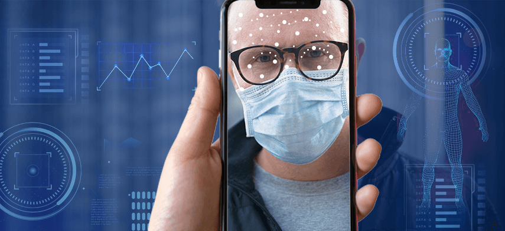
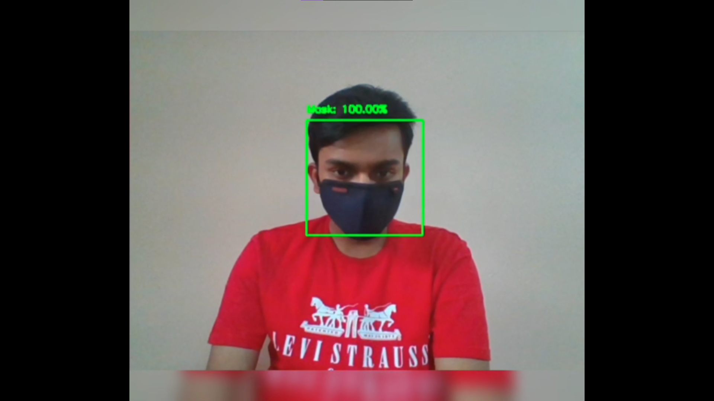
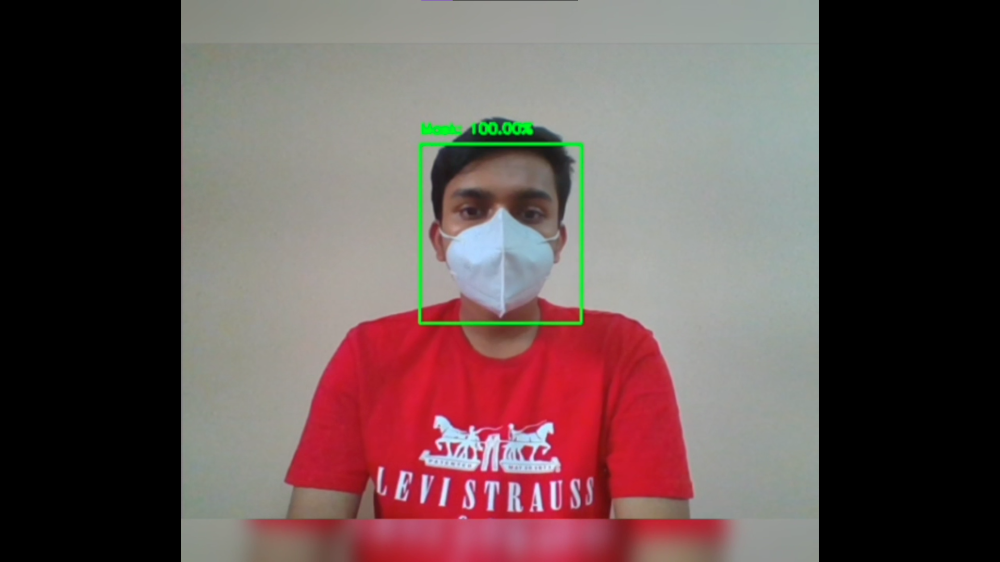
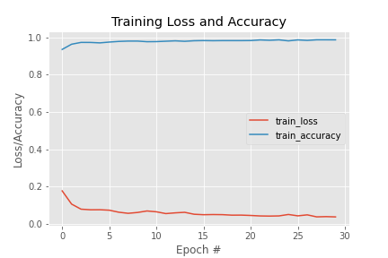

<div align="center">

# 😷 Face Mask Detection using OpenCV

[](https://python.org)
[](https://tensorflow.org)
[](https://opencv.org)
[](https://streamlit.io)
[](LICENSE)

**Real-time face mask detection powered by a fine-tuned MobileNetV2 model, Caffe SSD face detector, and a beautiful Streamlit web app — achieving 99% accuracy.**



</div>

---

## 📋 Table of Contents

- [About the Project](#-about-the-project)
- [Features](#-features)
- [Architecture](#-architecture)
- [Project Structure](#-project-structure)
- [How It Works](#-how-it-works)
- [Models Used](#-models-used)
- [Dataset](#-dataset)
- [Installation](#-installation)
- [How to Run](#-how-to-run)
- [Streamlit Web App](#-streamlit-web-app)
- [Results & Screenshots](#-results--screenshots)
- [Training Plot](#-training-plot)
- [Conclusions](#-conclusions)
- [Libraries Used](#-libraries-used)

---

## 🧐 About the Project

This project implements a **real-time face mask detection system** that:

1. Detects human faces in images, videos, or live webcam streams.
2. Classifies each detected face as **Mask** ✅ or **No Mask** ❌ with a confidence percentage.

Two face-detection approaches were evaluated:
| Approach | Technology | Performance |
|---|---|---|
| Haar Cascades | OpenCV built-in | ⚠️ Limited — struggles with dark masks and angled faces |
| **Caffe SSD** (**recommended**) | ResNet-10 pre-trained model | ✅ Robust, fast, works at multiple angles |

Both are combined with a **fine-tuned MobileNetV2** mask predictor that achieves **~99% accuracy**.

---

## ✨ Features

- 🎯 **99% mask classification accuracy** using transfer learning on MobileNetV2
- 🖼️ **Upload Image** mode — run detection on any static image
- 🎥 **Upload Video** mode — process and annotate entire video files
- 📹 **Live Webcam** mode — real-time detection via your system camera
- 🎨 **Beautiful Streamlit UI** — dark glassmorphism theme with animated components
- 📊 **Detection summary** — face count, mask/no-mask breakdown, per-face confidence
- ⬇️ **Download** annotated images and videos
- ⚙️ **Configurable confidence threshold** for face detection

---

## 🏗️ Architecture

```
Input (Image / Video / Webcam)
          │
          ▼
┌─────────────────────────┐
│   Caffe SSD Face        │   ResNet-10 300×300 SSD
│   Detector              │   deploy.prototxt +
│   (OpenCV DNN)          │   res10_300x300_ssd_iter_140000.caffemodel
└────────────┬────────────┘
             │  face bounding boxes
             ▼
┌─────────────────────────┐
│  Face ROI Preprocessing │   BGR→RGB, resize 224×224,
│                         │   MobileNetV2 preprocess_input
└────────────┬────────────┘
             │
             ▼
┌─────────────────────────┐
│  MobileNetV2 Mask       │   Fine-tuned classifier
│  Predictor              │   Output: [mask_prob, no_mask_prob]
└────────────┬────────────┘
             │
             ▼
   Annotated output with
   bounding boxes + labels
```

---

## 📁 Project Structure

```
Face-Mask-Detection-using-OpenCV/
│
├── app.py                          ← 🚀 Streamlit web application (frontend)
├── requirements.txt                ← Python dependencies
├── .gitignore
│
├── Model/
│   ├── trained_model.ipynb         ← MobileNetV2 training notebook
│   ├── caffe_model_detection.ipynb ← Caffe SSD real-time detection notebook
│   ├── haar_cascades_detection.ipynb ← Haar Cascades detection notebook
│   ├── deploy.prototxt             ← Caffe face detector architecture
│   ├── res10_300x300_ssd_iter_140000.caffemodel  ← Pre-trained face detector weights
│   ├── maskdetect_mobilenet_v2_predictor.model/  ← Fine-tuned mask predictor (SavedModel)
│   │   ├── saved_model.pb
│   │   └── variables/
│   └── requirements.txt            ← (original full env snapshot)
│
├── Dataset/                        ← (download separately from Kaggle — see below)
│   ├── with_mask/                  ←  ~1000 images with masks
│   └── without_mask/               ←  ~1000 images without masks
│
└── Images/
    ├── Project_vis.png
    ├── plot_v2.png                  ← Training accuracy/loss plot
    ├── testing_snap1.png
    └── testing_snap2.png
```

---

## 🔬 How It Works

### Step 1 — Data Preparation (`trained_model.ipynb`)
- Images loaded from `Dataset/with_mask/` and `Dataset/without_mask/`
- Resized to **224×224** (MobileNetV2 input size)
- Labels encoded with `LabelBinarizer` → class 0 (mask) / class 1 (no mask)
- 80/20 train-validation split
- `ImageDataGenerator` applies random **zoom** and **rotation** augmentations

### Step 2 — Model Fine-tuning
- **Base**: `MobileNetV2` pre-trained on ImageNet, top layers removed (`include_top=False`)
- **Head** added:
  ```
  AveragePooling2D → Flatten → Dense(128, ReLU) → Dropout(0.5) → Dense(2, Softmax)
  ```
- Training: **batch size = 12**, **30 epochs**, Adam optimizer
- Result: **~99% validation accuracy**

### Step 3 — Inference Pipeline
1. Each video frame / image is converted to a **blob** via `cv2.dnn.blobFromImage`
2. The Caffe SSD face detector returns **bounding boxes** for detected faces
3. Each face ROI is preprocessed and passed to the **mask predictor**
4. The output `[mask_prob, no_mask_prob]` determines the label and annotation color

---

## 🤖 Models Used

### MobileNetV2 (Mask Predictor)
- Lightweight, efficient deep CNN originally designed for mobile applications
- Pre-trained on ImageNet, fine-tuned on the face mask dataset
- Accuracy: **~99%** on validation set
- Stored as TensorFlow SavedModel in `Model/maskdetect_mobilenet_v2_predictor.model/`

### Caffe SSD (Face Detector) ✅ Recommended
- ResNet-10 based Single Shot Detector running via OpenCV's `dnn` module
- Fast, robust, works at different face angles and with dark-colored masks
- Files: `deploy.prototxt` + `res10_300x300_ssd_iter_140000.caffemodel`

### Haar Cascades (Face Detector) ⚠️ Legacy
- Classic Viola-Jones cascade classifier (`haarcascade_frontalface_alt2.xml`)
- Fast but **struggles** with faces at an angle or wearing dark-colored masks
- Provided in `haar_cascades_detection.ipynb` for reference

---

## 📦 Dataset

Dataset used: **Face Mask Dataset** by Omkar Gurav on Kaggle

🔗 **Download**: https://www.kaggle.com/omkargurav/face-mask-dataset

After downloading, place the files as:
```
Dataset/
├── with_mask/       ← ~1000 JPG images
└── without_mask/    ← ~1000 JPG images
```

> **Note:** The `Dataset/` folder is excluded from this repository via `.gitignore` due to its size (~60 MB). Download it separately to retrain the model.

---

## ⚙️ Installation

### Prerequisites
- Python 3.7 or higher
- pip
- (Optional) A virtual environment tool — `venv` or `conda`

### 1. Clone the repository
```bash
git clone https://github.com/YOUR_USERNAME/Face-Mask-Detection-using-OpenCV.git
cd Face-Mask-Detection-using-OpenCV
```

### 2. Create and activate a virtual environment
```bash
# Windows
python -m venv venv
venv\Scripts\activate

# macOS / Linux
python -m venv venv
source venv/bin/activate
```

### 3. Install dependencies
```bash
pip install -r requirements.txt
```

---

## 🚀 How to Run

### Option A — Streamlit Web App (Recommended)

```bash
streamlit run app.py
```

Then open your browser at `http://localhost:8501`

### Option B — Jupyter Notebooks

Open any notebook inside the `Model/` directory:

| Notebook | Description |
|---|---|
| `trained_model.ipynb` | Full training pipeline — load data, train MobileNetV2, save model |
| `caffe_model_detection.ipynb` | Real-time detection using Caffe SSD + saved mask model |
| `haar_cascades_detection.ipynb` | Real-time detection using Haar Cascades + saved mask model |

```bash
jupyter notebook Model/caffe_model_detection.ipynb
```

> ⚠️ **Update the hardcoded paths** in the notebooks to match your local directory structure.

---

## 🌐 Streamlit Web App

The `app.py` provides a fully interactive web application with **three detection modes**:

### 📷 Upload Image
1. Select **"📷 Upload Image"** from the sidebar
2. Upload any JPG/PNG image
3. View the **original** and **annotated** side-by-side
4. See per-face results with confidence scores
5. Download the annotated image

### 🎥 Upload Video
1. Select **"🎥 Upload Video"** from the sidebar
2. Upload an MP4/AVI/MOV video
3. Click **"🚀 Run Detection on Video"**
4. Watch live frame-by-frame preview as it processes
5. Download the fully annotated video

### 📹 Webcam (Live)
1. Select **"📹 Webcam (Live)"** from the sidebar
2. Click **"📹 Start Webcam Detection"**
3. A native OpenCV window opens with real-time detection
4. Press **Q** to quit

> 💡 **Tip**: Use the **Face Detection Confidence** slider in the sidebar to tune sensitivity.

---

## 📸 Results & Screenshots

### Mask Detected ✅


### No Mask Detected ❌


---

## 📈 Training Plot

The plot below shows accuracy and loss curves for the MobileNetV2 mask predictor over 30 epochs:



---

## 🏁 Conclusions

- The **Caffe SSD** face detector significantly outperforms Haar Cascades — especially for dark masks and non-frontal faces.
- **MobileNetV2** with transfer learning is an excellent choice: lightweight, fast, and achieves **~99% accuracy** with minimal training data (~2000 images).
- The **Streamlit** frontend makes the model accessible to non-technical users with a modern, intuitive UI.
- This project demonstrates a complete **end-to-end computer vision pipeline**: data preparation → model training → deployment.

---

## 📚 Libraries Used

| Library | Purpose |
|---|---|
| `tensorflow` / `keras` | Model training and inference |
| `opencv-python` | Video/image processing, DNN module, drawing |
| `imutils` | Video stream utilities and frame resizing |
| `numpy` | Numerical operations |
| `Pillow` | Image loading and manipulation |
| `scikit-learn` | Label encoding, train/test split |
| `matplotlib` | Training plots |
| `streamlit` | Web application frontend |

---

<div align="center">

Made with ❤️ | Face Mask Detection using OpenCV

</div>
